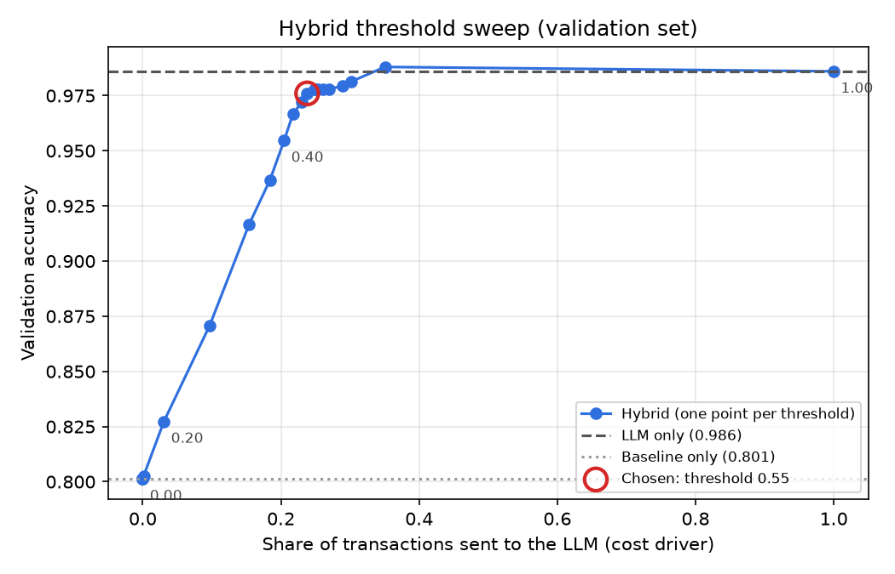

# Transaction Categoriser — ML baseline vs LLM vs hybrid

> **Portfolio README — fill in the bracketed parts with YOUR real numbers at the end (GUIDE.md, Step 9).**

Card statements say `AMZN MKTP UK*2K4LZ93`; customers want to see **Shopping · Amazon**.
This project compares three ways to categorise transactions and measures what each one costs:

| System | Accuracy (test) | Accuracy on new merchants | Merchant accuracy | Cost / 1k txns | p95 latency |
|---|---|---|---|---|---|
| TF-IDF + logistic regression | [ ] | [ ] | – | ~$0 | [ ] |
| LLM only ([model]) | [ ] | [ ] | [ ] | [ ] | [ ] |
| **Hybrid (threshold [ ])** | [ ] | [ ] | [ ] | [ ] | [ ] |

**Key finding:** [one sentence, e.g. "The hybrid keeps X% of LLM-only accuracy while sending only Y% of transactions to the LLM, cutting cost by Z×."]



## How it works
1. **Baseline** — character n-gram TF-IDF + logistic regression. Near-free, very accurate on merchants it has seen.
2. **LLM** — batched prompts with structured JSON output, strict validation, and a cache.
3. **Hybrid router** — keep the baseline's answer when its confidence ≥ threshold, otherwise ask the LLM.
   The threshold is chosen on the validation set only.

## Data
Synthetic, generated by `src/txncat/generate_data.py`: realistic card descriptors (processor prefixes, truncation,
reference codes) with a **merchant-level split** — ~30% of val/test transactions come from merchants never seen in training.
[Limitations: one paragraph.]

## Run it
```bash
make setup && make data && make db && make baseline && make test
cp .env.example .env   # add your API key and prices
make eval              # writes reports/
make serve             # http://localhost:8000/docs
```

## What I would do next
[2–4 bullets]
