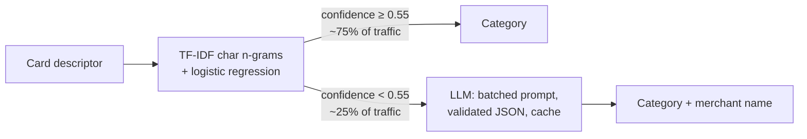

# Transaction Categoriser — classical ML vs LLM vs a confidence-routed hybrid

Card statements say `AMZN MKTP UK*2K4LZ93` or `SQ *KEBAB KING GLASGOW`; customers want to see
**Shopping · Amazon** and **Restaurants · Kebab King**. This project compares three ways to
categorise card transactions and measures what each one costs in accuracy, money and latency.

**Key finding:** a hybrid that lets a TF-IDF + logistic-regression model answer when it is
confident, and sends the rest to an LLM, answers **75% of transactions instantly at ~$0** and
cuts LLM cost **3.8×** versus LLM-only — at **96.7%** test accuracy (LLM-only 98.7%,
classical baseline 78.6%). Almost all remaining errors come from **6 merchants**.

## Results (test set, 1,500 transactions, evaluated once)

| System | Accuracy (95% CI) | Macro F1 | New merchants | Known merchants | Cost / 1k txns | p50 latency | p95 latency |
|---|---|---|---|---|---|---|---|
| TF-IDF + logistic regression | 0.786 (0.765–0.807) | 0.786 | 0.287 | 1.000 | ~$0 | 0.03 ms | 0.03 ms |
| LLM only (Kimi K2.6, thinking off) | **0.987** (0.981–0.992) | 0.981 | **0.982** | 0.989 | $0.094 | 561 ms | 1,280 ms |
| **Hybrid, threshold 0.55** | 0.967 (0.957–0.976) | 0.963 | 0.889 | **1.000** | **$0.025** | **0.03 ms** | 825 ms |

- *New merchants* = merchants that never appear in training (30% of test rows) — the realistic hard case.
- Latency is per transaction (an LLM call's time is split across its batch of 20).
- 95% confidence intervals from 2,000 bootstrap resamples. Full tables: [`reports/results.md`](reports/results.md).


The sweep has a sharp knee: sending the **least confident ~22%** of transactions to the LLM
buys almost the entire accuracy gain; sending more adds very little.

## How it works



1. **Baseline** — character n-gram TF-IDF (`char_wb`, 2–5) + logistic regression. ~0.03 ms per
   transaction, perfect on merchants it has seen, but only 29% on new ones.
2. **LLM classifier** — prompt with the category taxonomy and few-shot examples; 20 descriptions
   per call; the JSON answer is extracted, parsed and validated item by item (a malformed or
   missing item becomes `Unknown`, never a crash or a shifted answer); results are cached.
3. **Hybrid router** — keep the baseline's answer when its confidence ≥ threshold, otherwise ask
   the LLM, sending all uncertain rows in one batched call.
4. **Evaluation harness** — accuracy with bootstrap CIs, macro F1, per-class metrics, slices by
   new/known merchant, merchant-name accuracy (strict and lenient), cost per 1k, p50/p95 latency,
   a threshold sweep, a confusion matrix, and predictions stored in SQLite for error analysis.
5. **Service** — FastAPI (`POST /categorise`, `GET /health`) with Pydantic validation, packaged
   with Docker.

## Design decisions (each backed by a measurement)

| Decision | Evidence (validation set) |
|---|---|
| Character n-grams, not words | Accuracy on new merchants: char 0.338–0.358 vs word 0.267. Words fail on `AMZN` vs `AMAZON`, truncation and glued words. |
| `char_wb` over `char` | `char` is +2 points on new merchants but needs 54% more features; 2 points on 450 rows is within noise (±4–5 points). |
| LLM **thinking off** | Same accuracy (1.000 vs 0.995 on 200 rows = 1 row), but 4.3× cheaper and faster: ~82% of thinking-mode output tokens were hidden reasoning. |
| Batch size 20 | Batching cuts cost 5× (the system prompt is no longer resent per transaction); 20 is within 12% of the cheapest size, and a bad response loses 20 rows, not 50. Accuracy did not change with batch size. |
| Threshold 0.55 | Rule fixed **before** looking at test: lowest LLM share whose validation accuracy is within 1 point of LLM-only. |

## What the errors say

- **The baseline matches word fragments, not meaning.** Six unseen merchants cause ~90% of the
  hybrid's errors, each through a misleading fragment shared with a known merchant:
  `VISION EXPRESS` → Groceries (like `TESCO EXPRESS`), `ZABKA POLSKA` → Bills (like `PGE POLSKA`),
  `NOW TV` → Bills (like `TV LICENCE`), `JUSTEAT.CO.UK` → Shopping (like online shops).
  The baseline is *confident* on these, so they never reach the LLM.
- **Validation was optimistic.** The hybrid–LLM gap was 1 point on validation and 2 on test,
  because test contains different unseen merchants. The chosen threshold sat on the steep part of
  the curve; a point with more margin would be more robust. (Not re-tuned after seeing test.)
- **LLM errors are rare and mostly taxonomy questions**: Trainline → Transport (our rule says
  trains between cities are Travel), PlayStation Network → Subscriptions (games *and* PS Plus).
- **Merchant names:** the LLM scores 0.81 on strict matching but 0.95 when "Tesco Express" counts
  as "Tesco" — most mismatches are valid naming variants, a property of the metric.

## The trade-off, per 1 million transactions

| | LLM cost | Miscategorised | Answered instantly |
|---|---|---|---|
| Baseline | ~$0 | ~214,000 | 100% |
| LLM only | ~$94 | ~13,000 | 0% |
| Hybrid | ~$25 | ~33,000 | 75% |

At these LLM prices the saving alone is modest; the stronger case for the hybrid is **latency**
(three in four transactions are instant) and **resilience** (75% of traffic keeps working if the
LLM provider is down). A higher threshold buys accuracy back at more LLM cost — that choice is a
product decision, and the sweep shows its exact price.

## Data

Synthetic, from [`src/txncat/generate_data.py`](src/txncat/generate_data.py) (`--seed 42`):
9,000 card descriptors in 11 categories with realistic noise — payment-processor prefixes
(`SQ *`, `SUMUP *`), truncation, reference codes, glued words, country suffixes. The split is
**by merchant**: ~30% of validation and test rows come from merchants never seen in training,
so the evaluation measures generalisation rather than memorisation.

**Limitations.** Real transaction data is private, so the noise is only as realistic as the
generator's rules. Labels have no noise, no merchant belongs to two categories, merchant
frequencies are flat (real spending follows a power law), and currency is derived from the
description text. Merchants are well-known brands, which flatters the LLM; small local
businesses would be harder. Before production I would validate on a few hundred hand-labelled
real transactions.

## Run it

```bash
python -m venv .venv && source .venv/bin/activate     # Windows: .venv\Scripts\activate
pip install -e ".[dev]"
python -m txncat.generate_data                       # data/{train,val,test}.csv
python -m txncat.db                                   # SQLite for exploration (sql/analysis.sql)
python -m txncat.baseline                             # trains models/baseline.joblib
pytest -q                                             # 41 tests, no API key needed

cp .env.example .env                                  # add a Moonshot API key and prices
python -m txncat.evaluate                             # writes reports/ (reuses saved LLM predictions)
uvicorn txncat.api:app --reload                       # http://localhost:8000/docs
```

**Docker**
```bash
docker build -t txncat .
docker run --rm -p 8000:8000 --env-file .env txncat
```
Layered build (dependencies cached separately from code), non-root user, healthcheck. The model
is baked into the image; the API key is passed at runtime and never stored in it.

## Project structure

```
src/txncat/
  generate_data.py   synthetic descriptors with a merchant-level split
  categories.py      the taxonomy (single source of truth)
  db.py              CSV -> SQLite loader (parameterised, idempotent)
  baseline.py        TF-IDF + logistic regression with confidence scores
  llm_client.py      provider-agnostic client (Moonshot), retries with backoff
  llm_classifier.py  prompt, defensive JSON parsing, batching, cache, cost accounting
  router.py          confidence-based hybrid
  evaluate.py        metrics, threshold sweep, final test evaluation, reports
  api.py             FastAPI service
sql/analysis.sql     exploratory and error-analysis queries
tests/               41 unit tests (fakes instead of network calls)
notes/               step-by-step experiment notes
reports/             results, plots, saved LLM predictions
```

## What I would do next

- **Merchant override table** fed by customer corrections — six entries would remove ~90% of the
  hybrid's remaining errors — plus monitoring of error rate per merchant.
- **Novelty detection:** route descriptors that look unlike anything in training to the LLM even
  when the baseline is confident.
- **Merchant names for baseline-routed rows** (75% of traffic currently gets none), e.g. a lookup
  built from the LLM's answers; and strip city names from LLM merchant names in the prompt.
- **Distillation:** train the cheap model on the LLM's labels so the LLM share shrinks over time.
- **Calibration** of baseline probabilities, and validation on real labelled transactions.
- **Shared cache** (e.g. Redis) instead of a JSON file, for concurrent API requests.
