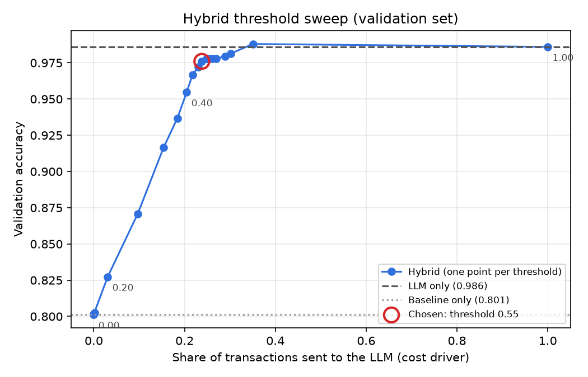
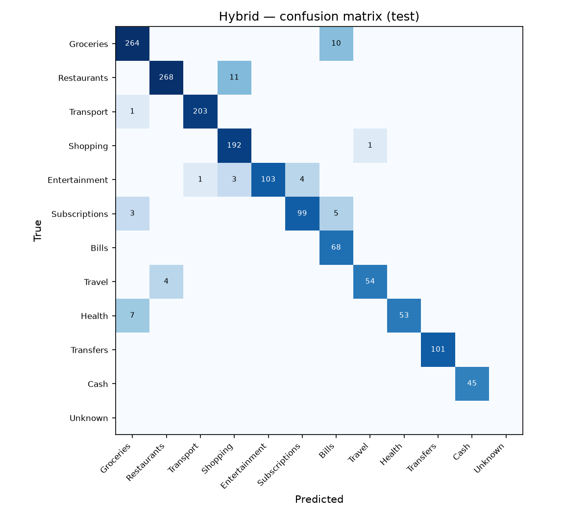

# Results

## Test set (1500 rows, evaluated once)

| system | accuracy | acc_ci95 | macro_f1 | acc_seen | acc_unseen | merchant_acc_strict | merchant_acc_lenient | llm_share | cost_per_1k_usd | latency_p50_ms | latency_p95_ms |
|---|---|---|---|---|---|---|---|---|---|---|---|
| baseline | 0.786 | 0.765–0.807 | 0.786 | 1.000 | 0.287 | n/a | n/a | 0.000 | 0.000 | 0.033 | 0.033 |
| llm_only | 0.987 | 0.981–0.992 | 0.981 | 0.989 | 0.982 | 0.812 | 0.948 | 1.000 | 0.094 | 560.765 | 1280.259 |
| hybrid@0.55 | 0.967 | 0.957–0.976 | 0.963 | 1.000 | 0.889 | 0.227 | 0.244 | 0.245 | 0.025 | 0.033 | 824.604 |

Cost uses the prices in `.env`. Latency is per transaction: an LLM call's time is split
evenly across its batch of 20, so a real-time user waiting for one call waits ~20x longer.
acc_ci95 = 95% bootstrap confidence interval for accuracy. Merchant accuracy counts rows
with no extracted merchant as wrong; the baseline never extracts merchants (n/a), so the
hybrid only has merchant names for the rows it sent to the LLM.

## Threshold selection (validation set only)

Rule (fixed before looking at test): lowest LLM share whose validation accuracy is within 0.01 of LLM-only validation accuracy (0.986).

**Chosen threshold: 0.55** (val accuracy 0.976, LLM share 0.238).

| threshold | llm_share | val_accuracy | val_macro_f1 |
|---|---|---|---|
| 0.00 | 0.000 | 0.801 | 0.817 |
| 0.05 | 0.000 | 0.801 | 0.817 |
| 0.10 | 0.000 | 0.801 | 0.817 |
| 0.15 | 0.001 | 0.803 | 0.817 |
| 0.20 | 0.031 | 0.827 | 0.838 |
| 0.25 | 0.097 | 0.871 | 0.876 |
| 0.30 | 0.154 | 0.917 | 0.909 |
| 0.35 | 0.184 | 0.937 | 0.925 |
| 0.40 | 0.205 | 0.955 | 0.943 |
| 0.45 | 0.217 | 0.967 | 0.955 |
| 0.50 | 0.230 | 0.972 | 0.960 |
| 0.55 | 0.238 | 0.976 | 0.965 |
| 0.60 | 0.248 | 0.978 | 0.968 |
| 0.65 | 0.250 | 0.978 | 0.968 |
| 0.70 | 0.254 | 0.978 | 0.968 |
| 0.75 | 0.261 | 0.978 | 0.968 |
| 0.80 | 0.270 | 0.978 | 0.968 |
| 0.85 | 0.289 | 0.979 | 0.970 |
| 0.90 | 0.301 | 0.981 | 0.973 |
| 0.95 | 0.351 | 0.988 | 0.982 |
| 1.00 | 1.000 | 0.986 | 0.980 |

## Hybrid per-class metrics (test)

| category | precision | recall | f1 | support |
|---|---|---|---|---|
| Groceries | 0.960 | 0.964 | 0.962 | 274 |
| Restaurants | 0.985 | 0.961 | 0.973 | 279 |
| Transport | 0.995 | 0.995 | 0.995 | 204 |
| Shopping | 0.932 | 0.995 | 0.962 | 193 |
| Entertainment | 1.000 | 0.928 | 0.963 | 111 |
| Subscriptions | 0.961 | 0.925 | 0.943 | 107 |
| Bills | 0.819 | 1.000 | 0.901 | 68 |
| Travel | 0.982 | 0.931 | 0.956 | 58 |
| Health | 1.000 | 0.883 | 0.938 | 60 |
| Transfers | 1.000 | 1.000 | 1.000 | 101 |
| Cash | 1.000 | 1.000 | 1.000 | 45 |
